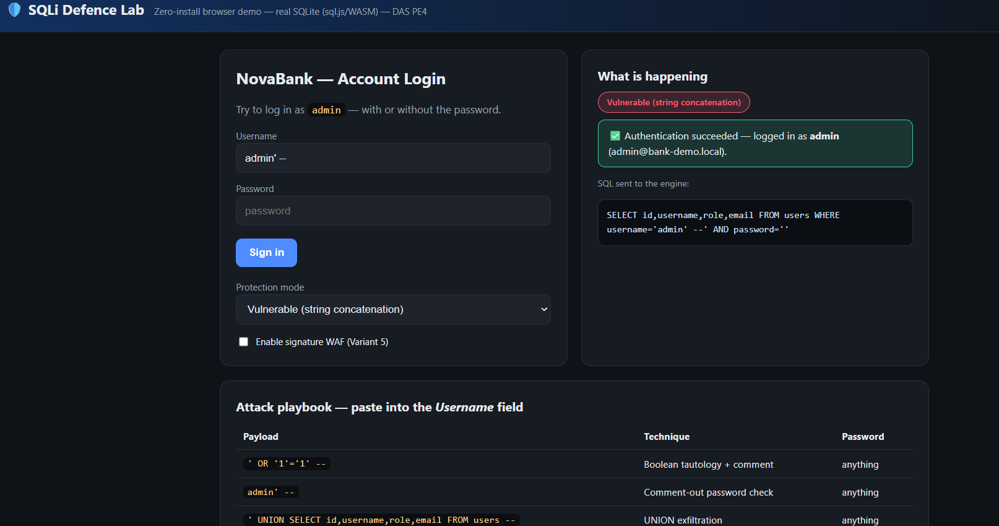
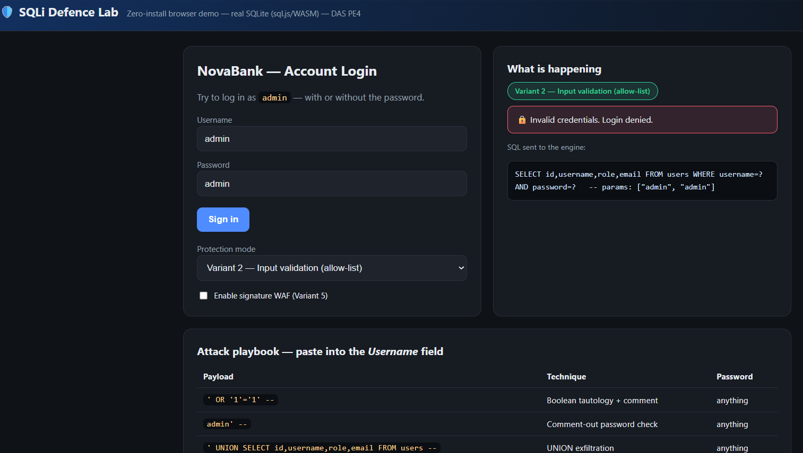
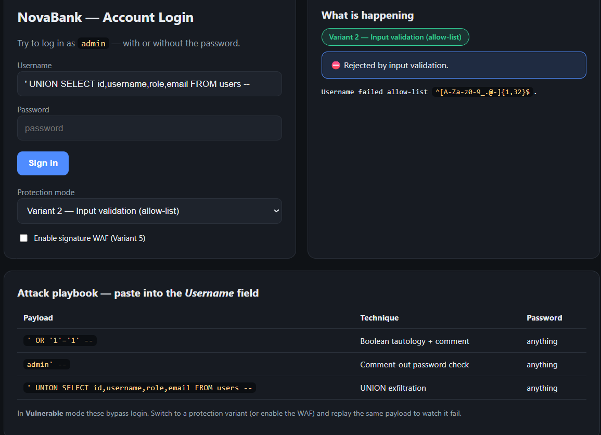

<h1 align="center">🛡️ SQLi Defence Lab</h1>
<p align="center"><b>SQL Injection with Protection — a defence-in-depth study & multi-variant live prototype</b></p>

<p align="center">
  
  
  
  
  
  
  
</p>

<p align="center">
  
  
  
  
</p>

---

A compact, reproducible study of **SQL injection and how to stop it**, built for
the DAS Project Element 4 (PE4). It pairs a **literature survey of ten
peer-reviewed papers (2023–2026)** with a **live prototype** that lets you fire
the *same* injection payload at a vulnerable login and at **five different
protection variants**, and watch the attack succeed once and fail everywhere else.

> **Ethics.** Everything here attacks a local demo database only. It is a teaching
> artefact for authorised coursework — never point it at a system you do not own.

---

## ✨ What's inside

| Path | What it is |
|------|-----------|
| [`docs/Literature_Survey.md`](docs/Literature_Survey.md) | 10-paper survey (2023–2026) + comparative table + research gap → objective |
| [`report/main.tex`](report/main.tex) | Full paper in the **Springer Nature** LaTeX template (`sn-jnl`) + `references.bib` |
| [`prototype/`](prototype/) | **Flask + SQLite** app: 1 vulnerable + 5 protected login variants + WAF |
| [`demo/index.html`](demo/index.html) | **Zero-install** browser demo — real SQLite in WASM (`sql.js`), no server |
| [`presentation/SQLi_Defence_Lab.pptx`](presentation/) | 13-slide deck with steps + real screenshots (auto-generated) |
| [`docs/Demo_Script.md`](docs/Demo_Script.md) | Minute-by-minute live-demo walkthrough |
| [`docs/figures/`](docs/figures/) | Captured screenshots of every demo state |

## 🎯 The idea in one line

```
Username:  admin' OR '1'='1' --      Password:  (anything)
```

In **Vulnerable** mode this comments out the password check and logs you in as
`admin`. Switch to any protection variant — or enable the WAF — and the identical
payload is rejected, while real credentials still work.

## 📸 Screenshots

**1. The attack works.** In *Vulnerable* mode, the username `admin' --` comments out
the password check — logged in as **admin** with no password. Note the tampered SQL
on the right (`... WHERE username='admin' --' AND password=''`).



**2. The defence holds.** Switch to a protection variant and the input is bound as a
**parameter** (`params: ["admin", "admin"]`), so it is treated as data, not code —
**login denied**.



**3. Rejected before the database.** With *Input validation (allow-list)*, a `UNION`
payload never even reaches SQL — it fails the allow-list `^[A-Za-z0-9_.@-]{1,32}$` and
is rejected instantly.



> Screenshots are from the zero-install browser demo ([`demo/index.html`](demo/index.html)),
> which runs a real SQLite database in the browser via WebAssembly.

## 🧱 The five protection variants

| # | Variant | Mechanism | Intervenes at |
|---|---------|-----------|---------------|
| 1 | Parameterized query | Input **bound as data**, never parsed as SQL | Database driver |
| 2 | Allow-list validation | Accept only characters valid for the field | Application input |
| 3 | ORM (SQLAlchemy) | Query built from objects → parameterized by construction | Data-access layer |
| 4 | Credential hashing | Salted PBKDF2; lookup by username, verify hash | Credential store |
| 5 | Signature WAF | Regex/heuristic inspection before execution | Request gateway |

**Thesis:** no single control is enough — real protection is *layered* (defence in depth).

## 🚀 Quick start (live prototype)

```bash
cd prototype
pip install -r requirements.txt
python app.py
# open http://127.0.0.1:5000
```

Prove it automatically:

```bash
python selftest.py     # replays the attack against every mode
```

Expected: only `vulnerable` (WAF off) is bypassed; every protected mode blocks it;
all legitimate logins still succeed.

### Or run the zero-install browser demo

Open [`demo/index.html`](demo/index.html) in any modern browser (needs internet
once, to fetch the SQLite WASM). It runs a **real** SQLite database in the tab.

## 📊 Result

| Mode | WAF off: bypass? | WAF on: bypass? | Legit login |
|------|:---:|:---:|:---:|
| Vulnerable | **YES** | No | — |
| Parameterized | No | No | OK |
| Allow-list | No | No | OK |
| ORM | No | No | OK |
| Hashed | No | No | OK |

Query cost of every defence: **< 1 ms**.

## 📚 Literature surveyed (approved venues, 2023–2026)

Crespo-Martínez et al. (2023, *Computers & Security*) · Alghawazi et al. (2023,
*Mathematics*) · Thalji et al. (2023, *IEEE Access*) · Alotaibi & Vassilakis
(2023, *Future Internet*) · Arasteh et al. (2024, *Neural Computing & Applications*)
· Paul et al. (2024, *J. Information Security & Applications*) · Qu et al. (2024,
*IEEE TIFS*) · Bakır (2025, *Arabian J. Science & Engineering*) · Floris et al.
(2025, *IEEE TIFS*) · Ahmed & Al-dabag (2026, *Computers*).

Full citations with DOIs: [`docs/Literature_Survey.md`](docs/Literature_Survey.md).

## 🛠️ Tech

Python · Flask · SQLite · SQLAlchemy · Werkzeug · sql.js (WebAssembly) · LaTeX (Springer Nature) · python-pptx

## 📄 License

Released under the [MIT License](LICENSE) for educational use.

---

*DAS PE4 — Team of 4. Built as a defence-in-depth demonstration of SQL injection and its mitigations.*
